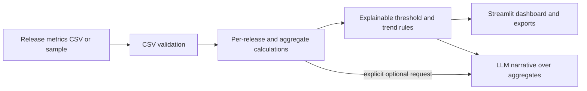

# Architecture

## Data and insight flow

## Design choices

- **Visible definitions:** formulas are documented and computed in Python so a reviewer can inspect them.
- **Configurable thresholds:** example guides can be changed to fit product context and are not presented as universal industry standards.
- **Context over scorecards:** the app does not combine metrics into one pass/fail quality score or rank teams and individuals.
- **Offline by default:** the rule-based insights work without API credentials and without sending data externally.
- **Aggregate-only LLM input:** optional narrative generation receives aggregate metrics and the rule-based signals, not raw defect reports or release rows.

## Production considerations

Connect approved data sources through least-privilege access, document ownership and definitions, add freshness/lineage metadata, segment by product risk only when useful, and preserve historical threshold changes. Calibrate metrics with teams before introducing release gates. Do not use individual-level metrics for performance management.

